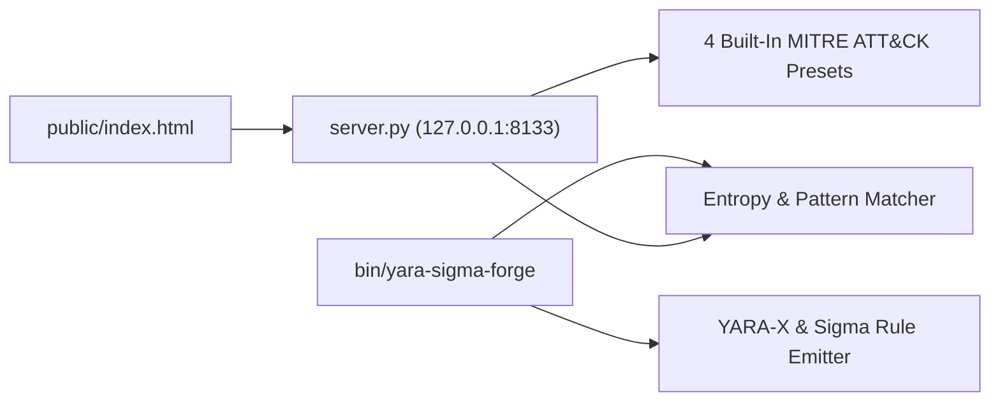

# YARA-X & Sigma Threat Rule Forge

[](https://zoth.nullai.tech/tools/yara-sigma-forge)
[](http://127.0.0.1:8133)
[](LICENSE)

Local-first YARA-X and Sigma threat detection rule compiler, Shannon byte-entropy scanner, and MITRE ATT&CK technique mapper. Compiles YARA (`.yar`) and Sigma (`.yml`) rules locally in the browser or CLI and evaluates payloads against built-in exploit and exfiltration signatures.

## Overview

**YARA-X & Sigma Threat Rule Forge** (`yara-sigma-forge`) provides a zero-dependency Python 3 loopback server (`127.0.0.1:8133`), standalone CLI rule compiler, and browser workstation integrated into **Zoth Studio v2** (`https://zoth.nullai.tech/tools/yara-sigma-forge`) and **ZothOS v3.4.0**.

| Property | Value |
| :--- | :--- |
| **Tool ID** | `yara-sigma-forge` |
| **Category** | `Security & Recon` |
| **Loopback Bind** | `127.0.0.1:8133` |
| **Zoth Studio v2 Dossier** | `https://zoth.nullai.tech/tools/yara-sigma-forge` |
| **Local Studio Route** | `http://127.0.0.1:3000/tools/yara-sigma-forge` |
| **Runtime Dependencies** | Python 3.10+ standard library (`http.server`, `socketserver`, `re`, `math`) |
| **License** | MIT (100% free and open-source) |

## Architecture



### Built-In Threat Signature Presets

| Preset ID | Rule Name | Severity | MITRE ATT&CK Techniques |
| :--- | :--- | :--- | :--- |
| `php-cgi-rce` | `ZOTH_PHP_CGI_Arg_Injection_RCE` | `CRITICAL` | `T1190`, `T1059.004` (CVE-2024-4577 PHP-CGI argument injection) |
| `agent-exfil-trap` | `ZOTH_Agent_MCP_Credential_Exfil` | `HIGH` | `T1552.001`, `T1048` (`.env` / `id_ed25519` curl/base64 exfiltration) |
| `elf-shellcode-stager` | `ZOTH_ELF64_Memfd_Reflective_Loader` | `CRITICAL` | `T1620`, `T1027` (`\x7fELF`, `memfd_create`, `fexecve`, `/proc/self/fd/`) |
| `ransomware-shadow-copy` | `ZOTH_Ransomware_Vssadmin_Delete_Shadows` | `CRITICAL` | `T1490`, `T1059.001` (`vssadmin`, `shadowcopy delete`, `bcdedit`, `wbadmin`) |

Payloads are marked `SUSPICIOUS` when any preset meets its `minMatches` threshold or when Shannon entropy ($H = -\sum p_i \log_2 p_i$) exceeds `5.5` bits/byte.

## Quickstart

```bash
git clone https://github.com/1nc0gn30/yara-sigma-forge.git
cd yara-sigma-forge

# Start the threaded loopback daemon on 127.0.0.1:8133
python3 server.py --port 8133
```

Open `http://127.0.0.1:8133` in a browser, or query the REST API directly:

```bash
# Health check
curl -s http://127.0.0.1:8133/health | python3 -m json.tool

# List built-in signature presets
curl -s http://127.0.0.1:8133/api/presets | python3 -m json.tool

# Scan a sample payload against all presets + Shannon entropy
curl -s -X POST http://127.0.0.1:8133/api/scan \
  -H "Content-Type: application/json" \
  -d '{"payload":"POST /index.php?%ADd+allow_url_include%3d1+%ADd+auto_prepend_file%3dphp://input"}' \
  | python3 -m json.tool
```

### REST API Endpoints

| Method | Route | Description |
| :--- | :--- | :--- |
| `GET` | `/health`, `/api/health` | Returns service health (`status: "ok"`), version, port (`8133`), and rule count (`4`). |
| `GET` | `/api/status` | Returns online status and available preset IDs. |
| `GET` | `/api/presets` | Returns full preset definitions, ASCII/regex patterns, severities, and MITRE mappings. |
| `POST` | `/api/scan` | Accepts JSON `{"payload": "..."}` (or raw text body); returns `entropy`, `bytes`, `verdict` (`CLEAN` or `SUSPICIOUS`), and per-rule match details. |
| `GET` | `/` | Serves the static browser workstation from `public/`. |

## CLI & ZothOS Usage

```bash
# Show CLI flags and options
./bin/yara-sigma-forge --help

# Output JSON installation and daemon telemetry
./bin/yara-sigma-forge --json

# Compile YARA or Sigma rules to stdout
./bin/yara-sigma-forge --compile yara --preset php-cgi-rce
./bin/yara-sigma-forge --compile sigma --preset agent-exfil-trap

# Compute Shannon entropy on a string or file path
./bin/yara-sigma-forge --entropy "0123456789abcdefABCDEF" --json

# Scan a string or file path against all built-in threat presets
./bin/yara-sigma-forge --scan "POST /index.php?%ADd+allow_url_include=1+%ADd+auto_prepend_file=php://input" --json

# Start the HTTP server via CLI
./bin/yara-sigma-forge --serve 8133

# Render the Unicode U+2800 Braille TUI sparkline view or JSON benchmark
./bin/yara-sigma-forge-tui
./bin/yara-sigma-forge-tui --json
```

## Testing & Verification

```bash
python3 -m pytest -q
```

Verifies Shannon entropy bounds, preset schema integrity and MITRE ATT&CK mappings, and ephemeral-port HTTP `/health`, `/api/presets`, and `POST /api/scan` detection accuracy.

## License

Released under the [MIT License](LICENSE). Copyright (c) 2026 [1nc0gn30](https://1nc0gn30.si) (`@1nc0gn30`) & [NullAI](https://nullai.tech).

100% free and open-source with zero paywalls. Optional support: [Buy Us a Coffee (Stripe)](https://buy.stripe.com/3cIfZg27PdKo2D64Ocfw40X).
